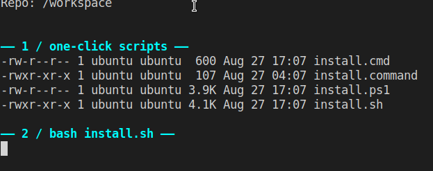
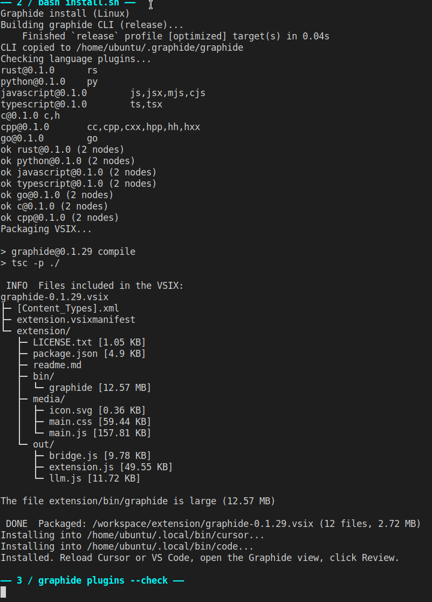
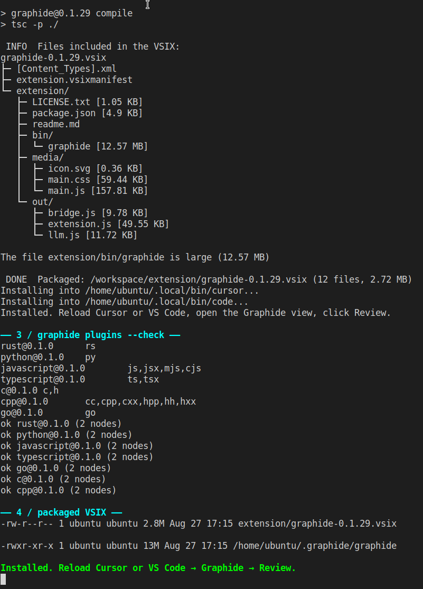
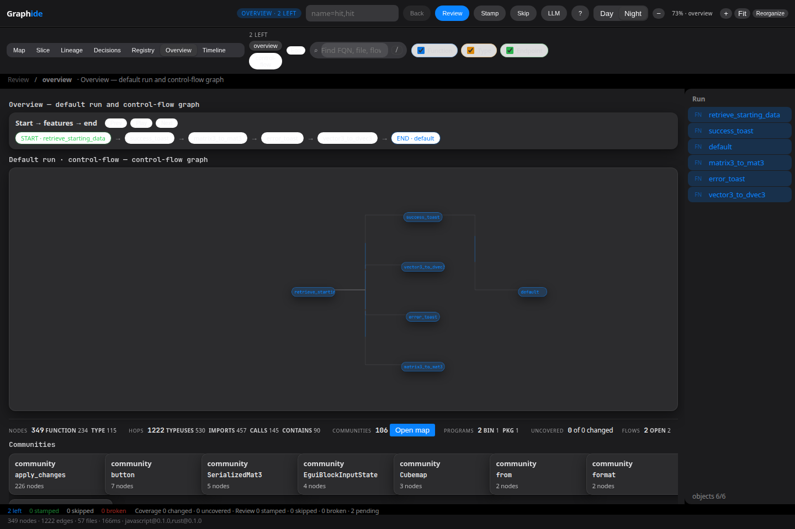
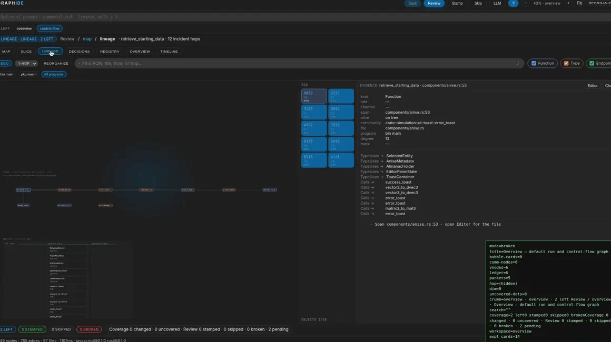

# Graphide

Review agent changes as flow graphs. Point the panel at any local repo.

Needs [Rust](https://rustup.rs) and [Node.js](https://nodejs.org) on PATH. Ubuntu also needs a C compiler: `sudo apt install build-essential`. macOS needs Xcode CLT: `xcode-select --install`.

The same VSIX installs into **Cursor** and VS Code (`engines.vscode` ^1.85.0). One-click installers try the `cursor` CLI first, then `code`. Language plugins (Rust, Python, JavaScript, TypeScript, C, C++, Go) ship in the CLI. Query langs match the Rust deriver: **TypeUses**, an **import map**, **Imports** edges when a name resolves through that map (`from pkg import T` / `import { T }` / `import pkg`), and **Endpoint** / Publishes / Subscribes / Reads. `graphide plugins --check` verifies every deriver after copy.

## Install (live)

Caps from `bash install.sh` in this VM. Windows (`install.cmd`) and macOS (`install.command`) run the same steps. More in [`install_sample/`](install_sample/).

**1. One-click scripts** in the Graphide source repo (not the folder you Review):



**2. CLI + plugins + VSIX** — every deriver must pass before the panel is installed into Cursor, then VS Code:



**3. Check again, then reload Cursor** → Graphide → **Review**:



## Review panel

After **Review**, the panel lands on **Overview** with a default run (`overview` + `control-flow`). Play walks **Start → features → end**. Other workspaces: **Map**, **Slice**, **Lineage**, **Decisions**, **Registry**, **Timeline**. Caps below are a live SolarSim pass after the Imports plugin match (**349 nodes · 1222 edges · 57 files**, **457 Imports**, harness **PASS 57/57**). The desk has **Day** and **Night** appearance (header control, key `D`, or `graphide.appearance`: `auto` / `day` / `night`). Auto follows the Cursor / VS Code color theme. The object rail is a source list of names; the footer is one caption. Endpoint / pub-sub hops match Rust on the same derivers; SolarSim’s edge mix did not change from Endpoints. More in [`UIUX_sample/`](UIUX_sample/).

**ADE Phase 1 (v0.2)** tip stack (drafts): [#371](https://github.com/livicter/graphide/pull/371) Trajectory → [#372](https://github.com/livicter/graphide/pull/372) Passport → [#373](https://github.com/livicter/graphide/pull/373) Immutable → polish [#374](https://github.com/livicter/graphide/pull/374)–[NEWPR] (through #381 fixtures + #382–#388 Trace chrome / Passport gate / edge-legend / legend focus-dim / keyboard node-step + #389 Passport impact-row chrome + #390 Trace empty-state + #391 seal status chip + #392 Passport empty-state + #393 Trace zoom chrome + #394 Passport→Trace row deeplink + #395 Trace→Passport row highlight + #396 Trace dep-list click→focus + #397 Passport contract/risk traj map + #398 Passport test-strategy traj map + #399 Trace hop-affordance + #400 Passport residual chrome + #401 Trace pin residual + [#402](https://github.com/livicter/graphide/pull/402) Passport hop residual badge + [#403](https://github.com/livicter/graphide/pull/403) Passport traj-hop adjacent residual + [#404](https://github.com/livicter/graphide/pull/404) Trace adj-residual legend + [#405](https://github.com/livicter/graphide/pull/405) Passport focus residual count + [#406](https://github.com/livicter/graphide/pull/406) Trace legend focus-residual + [#407](https://github.com/livicter/graphide/pull/407) Passport clear-focus cue + [#408](https://github.com/livicter/graphide/pull/408) Trace legend residual filter + [#409](https://github.com/livicter/graphide/pull/409) Trace residual-filter key + [#410](https://github.com/livicter/graphide/pull/410) Passport residual-filter mirror + [#411](https://github.com/livicter/graphide/pull/411) residual-filter clear-on-ws-leave + [#412](https://github.com/livicter/graphide/pull/412) residual-filter empty chrome + [#413](https://github.com/livicter/graphide/pull/413) Trace legend clear-filter cue + [#414](https://github.com/livicter/graphide/pull/414) Passport sticky clear-filter cue + [#415](https://github.com/livicter/graphide/pull/415) residual-filter count chip + [#416](https://github.com/livicter/graphide/pull/416) KeysPane residual-filter hint + [#417](https://github.com/livicter/graphide/pull/417) Keys R pressed-state + residual-filter toast). Explorer tabs **Trace** (`?trace=1`, `?traceEmpty=1` for empty chrome, `?seal=` for seal chip) and **Passport** (`?passport=1`, `?passportEmpty=1` for empty chrome) cover the Trajectory DAG, Passport gate + Architecture Delta vocabulary stub (fixture copy only — no live Delta mount), sealed immutable / FS-sandbox write-gate + visible `#adeSealChip` chrome, agent write-bus stub, Trace↔Passport deep-link, richer `#trajPinTip` chrome, sticky Passport gate/sign-off readability, expandable Passport impact rows, Trace empty-state chrome when the DAG has no nodes, Passport empty-state chrome when the fixture has no plan rows, Trace DAG zoom chrome (`#trajZoomBar` / `#trajScaleLayer`), Passport→Trace row deeplink (`data-ade-traj-hop` Open in Trace), and Trace→Passport row highlight (`data-ade-traj-active` / Show in Passport), and Trace dep-list click→focus (`data-ade-dep-focus` / `focusTrajectoryDep`), and Passport contract/risk → Trace traj mapping (`data-ade-contract-traj` / `data-ade-risk-traj`), and Passport test-strategy → Trace traj mapping (`data-ade-test-traj`), and Trace hop-affordance (`data-ade-hop-next` / `hopTrajectoryNext` / `.traj-hop-next`), and Passport residual / incomplete-signoff cue (`data-passport-residual` / `.passport-residual` on sticky `#passportSign`), and Trace pin residual cue (`data-tip-residual` / `.traj-pin-tip-residual` on `#trajPinTip`), and Passport hop residual badge (`data-passport-hop-residual` / `.passport-hop-residual` on gate path rows), and Passport traj-hop adjacent residual (`data-passport-adj-residual` / `.passport-adj-residual` + Trace `data-traj-adj-residual`), and Trace adj-residual legend chips (`data-adj-residual` / `.traj-legend-chip.adj-residual` on `#trajEdgeLegend`), and Passport focus-scoped residual count (`data-residual-scope="focus"` / `data-focus-residual-count` on sticky `#passportSign`), and Trace legend focus-residual count chip (`data-focus-residual` / `.traj-legend-chip.focus-residual` on `#trajEdgeLegend`), and Passport sticky clear-focus cue (`data-passport-clear-focus` / `.passport-clear-focus` on `#passportSign` residual), and Trace legend residual filter/toggle (`data-residual-filter-toggle` / `data-residual-filter` on `#trajEdgeLegend`), and Trace residual-filter keyboard shortcut (`R` / `r` → `toggleTrajResidualFilter` on Trace; Map keeps PATH), and Passport residual-filter mirror (`data-passport-residual-filter-toggle` / shared `trajResidualFilter` on sticky `#passportSign`; Passport `R` flips same filter), and residual-filter clear-on-ws-leave (`ADE_RESIDUAL_WS` in `setWorkspace` — leave Trace/Passport for Map/Slice clears filter; Trace↔Passport keeps sync), and residual-filter empty chrome (`data-residual-filter-empty` / `data-residual-filter-clear` when filter ON + zero bearings), and Trace legend clear-filter cue (`data-legend-clear-filter` / `.legend-clear-filter` when filter ON + bearings), and Passport sticky clear-filter cue (`data-passport-clear-filter` / `.passport-sticky-clear-filter` when filter ON + bearings). and residual-filter count chip (`data-residual-filter-count` / `data-filter-residual-count` / `.residual-filter-count` on Trace legend + Passport sticky when filter ON + bearings), and KeysPane residual-filter hint (`data-keys-r-binding` / `data-keys-residual-hint` / `syncKeysRRow` — Trace/Passport Keys show residual filter; Map keeps PATH), and Keys R pressed-state + residual-filter toast (`data-keys-r-pressed` / `aria-pressed` / `flashToast` Residuals on/off — Trace/Passport Keys mirror filter ON; Map clears pressed).


**Day** and **Night** on the same SolarSim snapshot:




**Overview** — scorecard, Play / Prev / Next, Evidence on the current hop:


**Map** — communities on the walk (this checkout after Review); click a bubble to Enter. **Slice** — Steiner control-flow:


**Lineage** — ego of the start hop, Used / Informed / Generated. **Registry** — snapshot audit:




**Decisions** — stamps, skips, broken attestations:


## Windows

1. Double-click **`install.cmd`**.
2. Reload **Cursor** or VS Code.
3. Open the folder to review → **Graphide** → **Review**.

The CLI is copied to `%USERPROFILE%\.graphide\graphide.exe`. You do not set `graphide.cliPath`.

## macOS

1. Double-click **`install.command`** (or run `bash install.sh` in Terminal).
2. If macOS blocks it: right-click → Open.
3. Reload the editor → **Graphide** → **Review**.

The CLI is copied to `~/.graphide/graphide`.

## Linux (Ubuntu)

```bash
sudo apt install build-essential
bash install.sh
```

Then reload **Cursor** or VS Code. If neither `cursor` nor `code` is on PATH, use **Extensions → … → Install from VSIX…** and pick the newest `extension/graphide-*.vsix`.

`install.sh` builds the CLI for this machine and bundles that binary. A Linux VSIX does not contain Windows or macOS CLIs. `install.cmd` / `install.ps1` are Windows-only. `install.command` is a Finder wrapper around `install.sh`.

## Package a VSIX

From this repo (the tree with `crates/graphide-cli`), not the folder you Review:

```bash
npm ci
npm ci --prefix extension
cargo build -p graphide-cli --release
npm run package
```

Root `npm ci` installs the Review webview and verify toolchain (`package-lock.json`). `npm ci --prefix extension` installs `tsc` and `vsce` (`extension/package-lock.json`). Those lockfiles must match their `package.json` versions.

`npm run package` writes `extension/graphide-<version>.vsix`. The archive holds compiled `out/extension.js`, `media/main.js`, `media/main.css`, `media/xyflow.css`, `media/icon.svg`, and `bin/graphide` (or `graphide.exe`) for this host. It does not hold TypeScript or `media/src/`. There is no Marketplace listing. Sideload the VSIX.

`install.sh` and `install.ps1` run the same package path after `cargo build --release`. They copy the CLI to `~/.graphide/` (Windows: `%USERPROFILE%\.graphide\`) and, when `cursor` or `code` is on PATH, install the VSIX. When neither editor CLI is present, they stop at the VSIX and print its path.

Review does not need an LLM key or a bridge token. Connect LLM is optional.

## Already have the extension?

Command Palette → **Graphide: Install (one click)**. Same build + copy on Windows, macOS, and Linux. If it asks for a folder, pick the **Graphide source repo** (this tree — has `crates/graphide-cli`), not the project you are reviewing.

## Review another repo

Open that repo (e.g. SolarSim) and click **Review**. Do **not** run `cargo build -p graphide-cli` there — that package only exists in this Graphide source repo. Use `%USERPROFILE%\.graphide\graphide.exe` (or `~/.graphide/graphide`) instead.

After Review the panel lands on **Overview** with a **default run**: an `overview` flow from derived entries and a `control-flow` Steiner along Calls/Reads/Writes/Publishes/Subscribes. No `flows.toml` required. Other workspaces stay: **Map**, **Slice**, **Lineage**, **Decisions**, **Registry**, **Timeline**. Search, kind filters, hop cards, and the inspect rail stay on every graph workspace. Programs are a legend filter (file projection), not a new IR kind.

Geometric zoom is automatic LOD on this canvas: **overview → labels → hops → source**. Zooming out past overview pops one clustering level (members → communities, or inner world → parent). **Enter** (click a run or bubble) is still a world jump — the camera never dumps every function.

This is not [Graphify](https://github.com/Graphify-Labs/graphify) and not a [Semantica](https://github.com/semantica-agi/semantica) embed. No Sigma.js / ForceAtlas2 hairball, no SPARQL, no ontology authoring, no entity merge. Graphide keeps a closed review vocabulary (`Function|Type|Endpoint`, spanned edges, stamps, coverage) and projects those objects through explorer workspaces.

## LLM (any host, or a local port)

Graphide can **call** an OpenAI-compatible host and **listen** so any LLM client can call it.

1. Command Palette → **Graphide: Connect LLM**. Pick Local Ollama (`http://127.0.0.1:11434/v1`), LM Studio (`:1234`), llama.cpp (`:8080`), OpenAI, or a custom `/v1` URL. Paste an API key if the host needs one (Secret Storage). Local hosts can leave the key empty.
2. Or set `graphide.llm.baseUrl` + `graphide.llm.model`.
3. In the Review panel, **LLM** (or `L`) opens Ask. Questions are grounded on the current derived flow (start → features → end). The model **never stamps**.
4. A local bridge listens on `127.0.0.1:8787` (`graphide.bridge.port`). **Graphide: Copy Bridge API Key**, then point any client at `http://127.0.0.1:8787/v1` with `Authorization: Bearer <key>`. Routes: `/health`, `/v1/review`, `/v1/path`, `/v1/ask`, `/v1/chat/completions`.

Without a host, Ask still answers from the review graph. Reinstall the VSIX after this change.

## Prompt

Optional: `name=hit,hit` (repeat flows with `;`). Hits are unique FQN suffixes. The slice is a Steiner tree on the derived graph — static extract, not a live debugger. Timeline **Uncovered** can copy a draft `[[flow]]` hit list from those FQNs; paste it into `flows.toml`. The desk does not apply the hint and does not stamp.

## Stamp and coverage

After Review, **Stamp** (or `S`) writes a human attestation to `.graphide/stamps/<flow>.json`. **Skip** (or `X`) leaves that flow unstamped for this session. The next Review rechecks saved stamps: a new hop is a scar on the tree (`StampBroken`).

If the folder is a git repo, Review extracts `HEAD^` as the parent revision so coverage can flag changed nodes not on any proposed tree, and bubble ids stay sticky across that cut. Set `graphide.parentRoot` to override, or pass `--no-parent` on the CLI.
